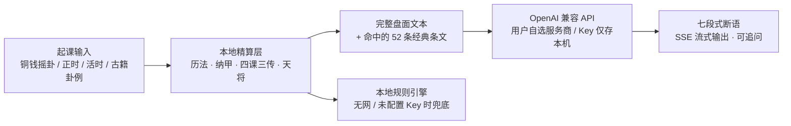

# 易课 · Yike

> 依据六爻与大六壬经典理论的安卓占课研习工具：**排盘精算在本地，断语义理交给 LLM**。

[](https://github.com/oficcejo/yike/releases)
[](https://developer.android.com/about/versions/marshmallow)
[](LICENSE)
[](#隐私与权限)
[](#从源码构建)

**[下载最新 APK →](https://github.com/oficcejo/yike/releases/latest)** · [版本历史](#版本历史) · [常见问题](#常见问题-faq) · [联系](#license)

Apache-2.0 授权 · Copyright © 2026 oficcejo · 联系：ws3101001@126.com

---

> ⚠️ **免责声明**
>
> 本项目是**中国传统术数典籍的数字化研习工具**，用于古籍义理、历法与排盘算法的学习和复盘，**不具备科学预测能力**。
> 应用内所有断语（含 AI 生成内容）均为或然性文本，**不得作为医疗、法律、投资、婚姻、出行安全等重大决策的依据**。
> 项目作者不对依据本工具产生的任何行为或后果承担责任。未成年人请在监护人指导下使用。

---

## 目录

- [设计思路](#设计思路)
- [功能一览](#功能一览)
- [经典依据](#经典依据)
- [快速开始](#快速开始)
- [配置项速查](#配置项速查)
- [从源码构建](#从源码构建)
- [目录结构](#目录结构)
- [技术实现要点](#技术实现要点)
- [隐私与权限](#隐私与权限)
- [版本历史](#版本历史)
- [常见问题 FAQ](#常见问题-faq)
- [License](#license)

## 设计思路

大模型的干支、节气、纳甲、四课三传**算不准**，也不该让它算。因此本项目把确定性的部分全部用代码精确实现，只把「按经典义理组织断语」交给模型：



- **盘面是本，断语是末**：即使完全不联网，起课、排盘、旺衰判定、应期推演、离线断语全部可用。
- **条文可追溯**：按盘面特征从内置经典库检索条目，连同编号一起注入 Prompt，要求模型逐条标注依据、使用或然表述。
- **不绑定厂商**：任何 OpenAI 兼容的 `/chat/completions` 端点都能接，含中转服务与本地 Ollama。

## 功能一览

### 六爻（京房易 / 《增删卜易》《卜筮正宗》）

| 模块 | 已实现 |
| --- | --- |
| 起卦 | 三枚铜钱六摇（老阴/少阴/少阳/老阳）、时间卦、指定古籍卦例复盘 |
| 卦体 | 京房八宫 64 卦自动生成、卦名/宫位/世应、游魂归魂、六冲六合、三合三刑 |
| 纳甲 | 八宫纳甲纳支、六亲、六神（按日干起）、伏神飞神、动变爻、进退神、反吟伏吟 |
| 旺衰 | 月建日辰旺相休囚死、十二长生、旬空月破、暗动、回头生克、原神忌神仇神 |
| 断法 | 《增删卜易·两现章》用神取舍、独发独静、尽静尽发、实空实破、应期十法 |
| 输出 | 用神链分析、吉凶倾向、应期候选、命中的经典条文编号 |

### 大六壬（《六壬断案》《大六壬指南》《御定六壬直指》）

| 模块 | 已实现 |
| --- | --- |
| 起课 | 月将中气过宫加时天地盘、十干寄宫起四课、昼夜贵人顺逆布十二天将、遁干 |
| 三传 | **九宗门全覆盖**：贼克（元首/重审）、比用（知一）、涉害、遥克、昴星、别责、八专、伏吟、返吟 |
| 课体 | 10 类课体格判定 + 12 天将类象 + 12 月将类象 |
| 神煞 | 旬空、日禄、驿马、旬丁、天马、墓神、胎爻、催官使者等 |
| 断法 | 毕法赋条目、分类占类神取用、三传生克与年命行年 |
| 输出 | 四课三传盘面、课体格局、类神定位、命中的经典条文编号 |

### 历法基准

1890–2070 年的**精确节气时刻**在构建期由天文历法库生成并内置，不依赖近似公式：

- 干支纪年月日时、五虎遁月、五鼠遁时、**晚子时换日**
- 太阳黄经节气（节 / 中气分列）、**月将中气过宫**、月建
- 真太阳时（可填经度修正）、旬空、日禄驿马、四时旺相休囚死、十二长生
- 12 类占题 → 六爻用神 / 六壬类神的映射表

### LLM 解读

- 七段式结构：定用神 → 旺衰链 → 格局动变 → 吉凶判断 → 应期 → 经典依据 → 提醒
- SSE 流式输出、支持多轮追问、思维链独立折叠展示、复制与分享
- Token 用量与「输出被截断」提示；推理模型参数自动兼容
- 无网络或未配置 Key 时自动降级为本地规则断语

## 经典依据

内置 **52 条**带编号的条目（`web/js/classics.js`），按盘面特征检索后注入 Prompt：

| 体系 | 典籍 |
| --- | --- |
| 六爻 | 《增删卜易》（用神章、两现章第三十二、独发独静章、伏神章、星煞章第三十三）、《卜筮正宗·黄金策·总断千金赋》及直解、十八问答、《卜筮全书》系统 |
| 大六壬 | 《六壬断案》、《大六壬指南》（课体要旨、毕法赋）、《御定六壬直指》（卷上起例/总论分论、卷下分类杂占、毕法赋）、《大六壬大全》、九宗门口诀、大六壬起例 |

> 条文中的「义理」类为对典籍规则的归纳表述，非原文逐字引录；引用原文时均标注篇目。研习请以原书为准。

## 快速开始

1. **安装**：下载 [最新 Release 的 APK](https://github.com/oficcejo/yike/releases/latest)，安卓 6.0 及以上直接安装。
2. **配置接口**：打开应用 → **设置** → 选服务商预设 → 填入自己的 API Key → **测试连接** → **保存**。Key 只存在本机，项目不内置任何密钥。
3. **起课**：「起课」页选六爻或大六壬、摇卦/正时起课、选占题（12 类）、可填本命行年与经度。
4. **解读**：切到「解读」页点 **AI 解读**；或点 **本地规则** 查看完全离线的推演结果。

内置预设（均可在设置里手改 Base URL 与模型名）：

| 预设 | Base URL | 默认模型 |
| --- | --- | --- |
| **DeepSeek（默认）** | `https://api.deepseek.com/v1` | `deepseek-flash` |
| DeepSeek 推理 R1 | `https://api.deepseek.com/v1` | `deepseek-reasoner` |
| OpenAI o 系列 / GPT-5 | `https://api.openai.com/v1` | `gpt-5-mini` |
| 腾讯混元 | `https://api.hunyuan.cloud.tencent.com/v1` | `hunyuan-turbo` |
| 通义千问（兼容模式） | `https://dashscope.aliyuncs.com/compatible-mode/v1` | `qwen-plus` |
| 豆包 / 火山方舟 | `https://ark.cn-beijing.volces.com/api/v3` | 填接入点 ID |
| Moonshot Kimi | `https://api.moonshot.cn/v1` | `moonshot-v1-8k` |
| 智谱 GLM | `https://open.bigmodel.cn/api/paas/v4` | `glm-4-flash` |
| OpenAI | `https://api.openai.com/v1` | `gpt-4o-mini` |
| 自定义 / 中转 | 手填 | 手填（支持 one-api、new-api、Ollama） |

> 厂商模型名会变动。若报「模型不存在」，请到对应控制台核对当前可用型号后填入模型名输入框。

## 配置项速查

| 项 | 默认 | 说明 |
| --- | --- | --- |
| `baseUrl` | `https://api.deepseek.com/v1` | OpenAI 兼容端点，内部自动补 `/chat/completions` |
| `apiKey` | 空 | 仅存本机 SharedPreferences / localStorage |
| `model` | `deepseek-flash` | 手填，随时可改 |
| `maxTokens` | 4096 | 上限 32768；推理模型建议 8192–16384 |
| `tokenParam` | `auto` | `max_tokens` / `max_completion_tokens`；`o*`、`gpt-5*` 自动切后者 |
| `reasoning` | 关 | 勾选后自动上调上限、去掉 `temperature`、折叠展示思维链 |
| `temperature` | 0.6 | 推理模型（o 系列等）不接受该参数 |
| `stream` | 开 | 关闭时走完整 JSON 一次性返回 |
| 真太阳时 / 经度 | 关 / 120°E | 影响时辰与月将加时 |

## 从源码构建

**环境**：JDK 17、Android SDK（platform 34 / build-tools 34）、Python 3 + `lunar-python`、Node.js（仅跑测试用）。无需 AndroidX、无需第三方 Gradle 依赖。

```bash
git clone https://github.com/oficcejo/yike.git
cd yike
python3 -m pip install lunar-python
bash tools/build_apk.sh
```

`tools/build_apk.sh` 共 5 步：生成精确节气表 → 生成安卓 6 兼容资源（CSS 变量展开、启动图标 PNG）→ 同步 H5 到 assets → 准备本机签名 → Gradle 构建，产物为根目录 `Yike-v1.1-android6.apk`。

**签名**：仓库**不含**密钥库与密码。首次构建时 `tools/prepare_keystore.sh` 会随机生成密码，并写入被 `.gitignore` 排除的 `android/signing.local.properties`。若已有自己的密钥库，手动创建该文件：

```properties
# android/signing.local.properties —— 切勿提交
YIKE_STORE_FILE=yike.keystore
YIKE_STORE_PASSWORD=<你的密钥库密码>
YIKE_KEY_ALIAS=<你的别名>
YIKE_KEY_PASSWORD=<你的密钥密码>
```

也可用环境变量 `YIKE_STORE_PASSWORD` 等，或 `./gradlew -PYIKE_STORE_PASSWORD=...`。未配置签名凭据时，release 构建会自动回退到 debug 签名（仅用于本地调试）。

**测试**（Node.js，界面测试需 `jsdom`、`acorn`）：

```bash
npm install --no-save jsdom acorn
node tools/test_core.js   # 47 项：历法基准、64 卦纳甲、古籍课例、8640 课全遍历
node tools/test_ui.js     # 37 项：jsdom 全流程、兼容层、ES5 语法断言
node tools/test_llm.js    # 34 项：SSE 流式、推理模型 content:null、400 重试、原生桥转义
```

## 目录结构

```
yike/
├── web/                     # H5 单页应用（全部算法与界面，纯 ES5）
│   ├── index.html
│   ├── css/app.css          # 主样式；app-compat.css 为构建期展开的兼容版
│   └── js/
│       ├── jieqi_data.js    # 1890–2070 精确节气表（构建期生成）
│       ├── calendar.js      # 历法 / 干支 / 旬空 / 旺衰 / 真太阳时
│       ├── data.js          # 64 卦纳甲、八宫、六亲六神、占题映射
│       ├── classics.js      # 52 条经典条文与检索
│       ├── liuyao.js        # 六爻排盘与断卦引擎
│       ├── liuren.js        # 大六壬九宗门起课与断课引擎
│       ├── llm.js           # Prompt 构造、API 通道、离线兜底
│       ├── app.js           # 界面与交互
│       └── polyfill.js      # 老 WebView 兼容垫片（最先加载）
├── android/                 # Java WebView 壳，无 AndroidX / 无第三方依赖
│   └── app/src/main/
│       ├── java/cn/ws9/liuyao/MainActivity.java  # 原生 HTTP + SSE 桥
│       ├── assets/www/      # web/ 的同步副本
│       └── res/
├── tools/                   # 构建、数据生成、资源同步、回归测试
├── LICENSE                  # Apache License 2.0 全文
├── NOTICE                   # 版权归属、联系邮箱与来源声明
└── README.md
```

## 技术实现要点

### 为什么请求走原生层

WebView 以 `file://` 加载页面时，JS 直接 `fetch` 大模型 API 会遇到跨域限制。安卓端由 `MainActivity.java` 用 `HttpURLConnection` 发请求并把 SSE 逐块回传给 JS；浏览器预览通道用 `fetch` + ReadableStream，两条通道共用同一套解析规则。

### 推理模型的 `content: null`

Android `org.json` 的 `optString("content", "")` 在字段为 JSON `null` 时返回**字符串 `"null"`** 而非默认值。推理模型思考阶段的 chunk 恰好是 `{"delta":{"content":null,"reasoning_content":"…"}}`，旧实现会把每个 chunk 的 `"null"` 拼进正文，导致满屏 null。现已用 `isNull()` + 严格判型处理，并将 `reasoning_content` / `reasoning` / `thinking` 分离到独立事件折叠展示，**不混入断语、不进入多轮上下文**。

### Token 预算

七段式断语约需 2500–4000 tokens。各家对「思维链是否占用同一上限」口径不同（DeepSeek `reasoning_content` 另计，多数中转与 vLLM 共用），因此默认给到 4096，推理模型建议 8192–16384。响应中识别 `finish_reason=length` 时会在断语末尾显示截断警告，并上报 token 用量。

### 安卓 6.0（API 23）兼容

| 问题 | 处理 |
| --- | --- |
| `ConcurrentHashMap.newKeySet()` 是 API 24+ | 改用 `Collections.newSetFromMap(...)` |
| 部分 ROM 默认未启用 TLS 1.2 | SDK ≤ 23 时通过 `Tls12Factory` 显式启用 |
| 旧 WebView 解析不了 `async/await` | 浏览器通道改 Promise 链，全部脚本按 `ecmaVersion:5` 校验 |
| Chrome 49- 不支持 CSS 变量 | 构建期展开 19 个变量生成 `app-compat.css`，与主样式同时加载 |
| 缺 `Object.assign` / `Array.find` / `NodeList.forEach` | `polyfill.js` 最先加载 |
| 老 UA 样式表缺 `[hidden]` | 显式补 `[hidden]{display:none!important}` |
| 老 Launcher 对 vector 图标支持不稳 | 生成 5 个密度 PNG |

## 隐私与权限

| 项 | 说明 |
| --- | --- |
| 权限 | 仅 `INTERNET` 与 `ACCESS_NETWORK_STATE`，无定位、通讯录、存储、自启动 |
| 本地数据 | API Key、设置、历史课例只存本机（SharedPreferences / localStorage），不上传 |
| 网络请求 | **只有**点击「AI 解读」或「测试连接」时，把盘面文本 + 检索到的经典条文 + 占题发往**你自己配置的**端点 |
| 离线能力 | 起课、排盘、六壬九宗门、六爻旺衰应期、经典库检索、本地规则断语全部离线可用 |
| 第三方依赖 | 运行时零第三方 SDK，无统计、无广告、无埋点 |

## 版本历史

| 版本 | 说明 |
| --- | --- |
| **v1.1.0** | 默认模型改为 `deepseek-flash`；最低支持降到 Android 6.0（API 23）；新增 polyfill、兼容 CSS、TLS 1.2 显式启用、PNG 启动图标；修复推理模型满屏 `null`；Token 默认 4096、推理模型开关、截断与用量提示 |
| v1.0.0 | 首版：六爻 + 大六壬双引擎、52 条经典条文、OpenAI 兼容 LLM 解读、离线兜底（Android 7.0+） |

## 常见问题 FAQ

<details>
<summary>点「AI 解读」没有反应 / 报错</summary>

先到「设置」点 **测试连接**。常见原因：Key 无效、模型名已变更、端点路径不对（应填到 `/v1` 一级）、设备网络无法访问该域名。安卓 6 设备若报 SSL 握手失败，请确认系统 WebView 与系统时间正常。
</details>

<details>
<summary>输出全是 null / 一片空白</summary>

v1.0.0 的已知问题，请升级到 v1.1.0。若新版仍出现，说明服务端返回了非标准结构，把「测试连接」的提示和断语区内容发 Issue 即可。
</details>

<details>
<summary>断语写到一半就停了</summary>

输出被 `maxTokens` 截断，断语末尾会有提示。到设置里调高上限（推理模型建议 8192–16384），或改用非流式一次性返回。
</details>

<details>
<summary>可以在电脑浏览器里用吗</summary>

可以直接打开 `web/index.html` 看界面与排盘。但浏览器受跨域限制，AI 解读需改用支持 CORS 的端点或本地中转；安卓端无此限制。
</details>

<details>
<summary>不配 API Key 能用吗</summary>

能。所有排盘功能与「本地规则」断语完全离线，AI 解读为可选增强。
</details>

## License

本项目采用 [Apache License 2.0](LICENSE) 授权，Copyright © 2026 oficcejo。版权归属、联系邮箱与第三方来源声明见 [NOTICE](NOTICE)。

相较 MIT，Apache-2.0 额外提供**明确的专利授权**，并对再分发提出以下要求：

| 义务 | 说明 |
| --- | --- |
| 保留声明 | 分发源码或二进制时必须随附 `LICENSE` 与 `NOTICE` |
| 标注修改 | 被修改过的文件须带有显著的变更说明 |
| 商标 | 不授予项目名称、标识的商标使用权，不得用于背书宣传 |
| 免责 | 软件按「现状」提供，不含任何明示或默示担保 |

**联系邮箱**：ws3101001@126.com（古籍校勘、规则争议、授权与合作事宜）

欢迎提交 Issue 与 PR，尤其是**排盘规则的古籍校勘**（请注明书名、篇目与原文依据）。本项目定位为传统术数文化研习工具，请勿用于商业占卜宣传或封建迷信活动。
